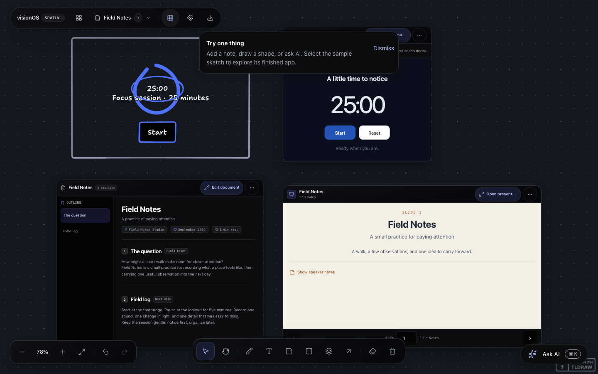
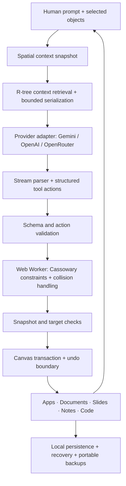

<div align="center">

# visionOS

### An AI collaborator. An infinite canvas. Work you can actually use.

Turn prompts and hand-drawn wireframes into **interactive applications, documents, presentations, notes, and code**—then keep working on them in the same space.

[](https://www.typescriptlang.org/)
[](https://nextjs.org/)
[](https://react.dev/)
[](https://tldraw.dev/)
[](LICENSE)

[Explore the workspace](#the-workspace) · [Under the hood](#under-the-hood) · [Run locally](#run-locally) · [Technical documentation](#technical-documentation)

</div>

<br />



<p align="center"><sub>A sketch, a runnable app, a document, and a slide deck—editable objects on one canvas. Screenshot from the existing test release.</sub></p>

---

## The workspace

**visionOS makes the canvas part of the AI interaction.** Select an object, refer to something nearby, or sketch what you want to build. The assistant receives structured spatial context and can create or modify canvas objects through validated tools.

The result stays useful after the conversation: apps run in previews, documents remain editable, decks can be presented and exported, and the original sketch stays alongside the work it informed.

| Start with | Make | Keep working |
| --- | --- | --- |
| A hand-drawn wireframe | A self-contained HTML, CSS, and JavaScript app | Run it on the canvas and request revisions |
| A question or a rough brief | Notes, a structured document, or code | Edit the existing object in place |
| A presentation idea | A native slide deck | Revise slides, present fullscreen, export editable PowerPoint |
| Shapes and relationships | Diagrams, connectors, groups, and layouts | Arrange the work spatially and undo changes |

### Sketch → runnable application

**Make Real** turns selected wireframes into applications directly on the canvas. The multimodal pipeline captures visual context, requests a complete application document, and places the result in a sandboxed preview. Generated apps can maintain their own local state through host-managed storage.

### Context → precise canvas actions

The assistant works with shape IDs, selection, geometry, hierarchy, bindings, and relevant content. It can create artifacts, revise existing objects, connect shapes, align a selection, and focus the viewport. Editing an existing app preserves its identity rather than creating a replacement window for every revision.

### Ideas → portable artifacts

Documents support section outlines, Markdown, mathematical notation, and highlighted code. Presentations support structured slide layouts, speaker notes, fullscreen playback, and editable `.pptx` export. Notes, code cards, vectors, and media can live alongside them.

---

## Under the hood

The engineering challenge is translating uncertain model output into useful, coordinated changes to a stateful spatial workspace.



### 01 / Spatial grounding

**The model receives a representation of the workspace, not just a chat transcript.**

- R-tree indexing with `rbush` supports spatial retrieval of relevant canvas objects.
- Context includes selection, viewport geometry, exact object identities, hierarchy, and arrow bindings.
- Bounded source serialization gives selected artifacts the content needed for editing without treating every object as an unrestricted prompt payload.
- Source-field caching avoids repeating serialization work while geometry and safety fields are refreshed.
- Canvas content is treated as untrusted reference material; it cannot grant permissions or override the user's request.

### 02 / Constraint-based placement

**Placement is computed by a spatial engine.**

A dedicated Web Worker uses **Kiwi.js**, a Cassowary constraint solver, together with collision handling to turn placement requests into canvas geometry. This separates model-generated content from layout computation and keeps solver work off the main rendering thread. Placement previews show where new work is expected to appear while generation is in progress.

### 03 / A controlled action pipeline

**A streamed response is not automatically a canvas mutation.**

Provider responses pass through parsing, schema validation, and host-side action handling. Object and snapshot checks protect against applying an edit to work that changed while the request was running. Locked shapes and parent relationships are respected. Transaction boundaries and rollback handling keep failed AI actions from leaving partially applied canvas changes.

The provider layer supports **Gemini, OpenAI, and OpenRouter**. Generation and canvas editing share versioned instructions and structured action contracts, while Make Real has a dedicated multimodal application-generation path.

### 04 / Generated-app execution

**Generated applications run behind a browser execution boundary.**

| Boundary | Implementation |
| --- | --- |
| Execution | An opaque-origin wrapper contains a nested, Blob-backed app iframe |
| Canvas access | Generated code is separated from the parent canvas DOM and cookies |
| App state | Host-managed virtual storage isolates state by app |
| Network access | Exact-origin permissions are bound to the app, workspace, restore epoch, and source version |
| External navigation | Clicked HTTPS links require host confirmation |
| Imported content | Imported apps start paused; source changes and restores reset grants |

External site access starts blocked. The user can allow an exact site for a run or remember access for that source version. An allowed remote script can read the app's data and communicate with its origin, so the permission is meaningful.

This is a browser sandbox, **not a complete network firewall**. Peer-to-peer APIs have documented best-effort restrictions; browser behavior, including WebRTC, limits absolute network containment.

### 05 / Recovery as a separate system

**Local persistence, recovery, and portable backups solve different problems.**

- The canvas uses browser-local persistence; an app-owned **IndexedDB recovery copy** separately records committed board state.
- Recovery detects conflicts instead of silently overwriting one copy with another. Restore decisions are checked against the reviewed revision and current canvas snapshot.
- Restoring saves the current workspace first, allowing a subsequent **Restore previous** operation.
- Versioned workspace backups package supported local media and generated-app storage, with explicit exclusions for content that cannot be embedded.
- Recovery has bounded queues and storage limits. Failures are surfaced with a portable-backup action rather than an unqualified “saved” claim.

Recovery is specific to the browser profile. Clearing site data or storage eviction can remove it, and edits made immediately before abrupt termination may not have committed. Download a workspace backup for a portable copy. Backups exclude provider keys, chat history, and app preferences.

---

## Run locally

Use **Node.js 20+** and **Bun**.

```bash
git clone https://github.com/Koushikktech/visionOS.git
cd visionOS
bun install
cp .env.example .env.local
bun run dev
```

Open **http://localhost:3000**. Explore the included sample or open the canvas, then add your **Gemini, OpenAI, or OpenRouter API key** when you want to use AI. Saving a key does not automatically send a draft.

<details>
<summary><strong>Provider keys and data flow</strong></summary>

Keys are stored in this browser when local storage is available, with session-storage or memory-only fallbacks. AI requests send the key, prompt, and relevant canvas context to the application's API, which forwards them to the selected provider. Some workflows include a canvas snapshot. Local-first storage does not mean AI inference happens on the device.

The test deployment is **bring your own key**. Server-held provider keys are ignored in production. For local development only, `.env.example` documents the explicit `ALLOW_SERVER_AI_KEYS=true` opt-in. Never expose provider credentials through `NEXT_PUBLIC_` variables.

OpenAI access uses an API key; ChatGPT subscription sign-in is not supported. Browser voice dictation depends on speech-recognition availability and the browser's service.

</details>

### Development commands

| Command | Purpose |
| --- | --- |
| `bun run dev` | Start the development server |
| `bun test` | Run the automated test suite |
| `bun run typecheck` | Check TypeScript |
| `bun run build` | Create a production build |
| `bun run start` | Serve the production build |

## Engineering map

| Area | Entry points |
| --- | --- |
| Canvas orchestration | [`Canvas.tsx`](src/components/Canvas.tsx), [`useSpatialAI.ts`](src/hooks/useSpatialAI.ts) |
| Spatial context and snapshots | [`spatialContext.ts`](src/lib/spatialContext.ts), [`spatialVision.ts`](src/lib/spatialVision.ts) |
| Off-thread layout | [`spatial.worker.ts`](src/workers/spatial.worker.ts) |
| Provider and tool contracts | [`src/lib/ai/`](src/lib/ai), [`src/app/api/ai/`](src/app/api/ai) |
| Native artifact types | [`src/shapes/`](src/shapes) |
| App execution and permissions | [`artifactRuntime.ts`](src/lib/artifactRuntime.ts), [`artifactNetworkPermissions.ts`](src/lib/artifactNetworkPermissions.ts) |
| Isolated app storage | [`artifactStorage.ts`](src/lib/artifactStorage.ts) |
| Recovery and backups | [`boardRecoveryPersistence.ts`](src/lib/boardRecoveryPersistence.ts), [`workspaceBackup.ts`](src/lib/workspaceBackup.ts) |

**Stack:** Next.js · React · TypeScript · tldraw · Gemini / OpenAI / OpenRouter · Web Workers · rbush · Kiwi.js · IndexedDB · PptxGenJS · KaTeX

## Release scope

The current release targets invited testers using their own provider keys. The implemented core is a local-first canvas with an AI collaborator, generated applications, editable artifacts, recovery, and exports.

Multi-agent orchestration is an experimental direction with code in the repository; it is **not part of the verified tester-release scope**. Accounts, hosted team collaboration, billing, and cloud synchronization are future work. Historical roadmap entries are ideas and implementation history, not proof that a feature ships.

## Technical documentation

- [Production audit plan](docs/PRODUCTION_AUDIT_PLAN.md)
- [Latest BYOK remediation and verification](docs/audit-evidence-2026-11-04/remediation/README.md)
- [Generated-app network permission evidence](docs/audit-evidence-2026-10-27/network-permissions/README.md)
- [Historical feature inventory and roadmap](docs/visionos_feature_inventory_and_roadmap.md)

## License

Project code is licensed under [MIT](LICENSE). Dependencies retain their own terms. In particular, `@tldraw/tldraw` has a separate license, reproduced in [the third-party notice](THIRD_PARTY_NOTICES/tldraw-3.15.6-LICENSE.md); the project's MIT license does not replace it.

---

<p align="center"><strong>Draw the idea. Build the artifact. Keep the context.</strong></p>
