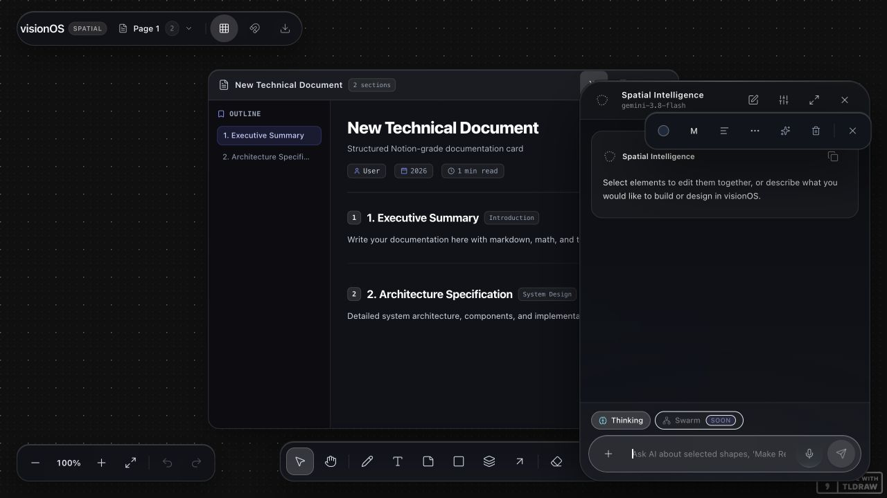

# visionOS production audit and implementation decision plan

Last consolidated: 27 October 2026. **Current deployment scope: BYOK test deployment; not a production-readiness claim.** Testers supply their own Gemini or OpenRouter key. SaaS accounts and server-funded provider quotas are future scope. This document began as an audit and implementation plan; the audit findings and earlier checkpoints are retained as history. The Oct 27 implementation and verification addendum below supersedes earlier current-status claims; Oct 26, Oct 23 and earlier checkpoints remain historical. The pre-existing feature roadmap was preserved.

## 1. Product understanding and evidence

The product is a local-first creative workspace: people draw, organize notes and documents, inspect code, and generate interactive apps on one persistent infinite canvas. Its distinguishing experience should be direct manipulation plus an AI collaborator that understands spatial context, preserves existing work, and makes reliable, reversible changes. The dark floating Apple-inspired controls should support that experience.

The intended product includes automatic context gathering and the existing Swarm feature. Earlier documents explicitly record that removing Swarm or introducing manual interaction/vision modes was rejected; that remains the product-history context. **On 23 October the user excluded Swarm from this phase: preserve the existing feature and make no further Swarm changes in this phase.** Accounts, multiplayer, WebXR and a marketplace are not automatically launch requirements.

**Evidence collected:** repository-wide inventory and cross-cutting source review of application routes, AI orchestration, worker/action pipeline, seven custom shapes, mounted HUD components, persistence/export paths, styles, tests, configuration and all six product documents including README. Detailed review concentrated on production-critical paths. This is not a claim that every line or every possible runtime state has been exhaustively verified.

| Check | Actual result |
| --- | --- |
| Prior audit checkpoint: `bun test` | 245 passed, 0 failed; 16 files, 2,822 assertions. This predates the current implementation changes. |
| Prior audit checkpoint: `bun run typecheck` / `bun run build` | Passed at that checkpoint; this is not verification of the current combined changes. |
| Prior production browser smoke check | Local production server, 1280×720 viewport: launch, onboarding dismissal, manual document creation, text editing, AI panel and reload persistence. It predates the current overlay work. |
| Earlier targeted checks | At the inherited-lock checkpoint: 26 tests passed, 75 assertions across worker protocol, spatial serialization and MVP protocol suites; typecheck and diff check passed. |
| Earlier draft/source safety checks | At the focused checkpoint: 20 tests passed (51 assertions) across draft recovery, exact source authorization and the actual worker protocol. Later browser checks below covered code-card recovery and artifact pause/run behavior. |
| Earlier artifact runtime/storage checks | 72 tests passed, 325 assertions across six focused files; `bun run typecheck` and `git diff --check` passed at that checkpoint. Those tests exercise generated `srcdoc` and source contracts. The previous production-browser checks below verify exact current IndexedDB-row commit, reload and clear/undo recovery. This predates the current wrapper, origin-specific permission UI and host-confirmed links; browser-wide network containment and primary-board durability acknowledgement remain unverified/unavailable. |
| Earlier combined checkpoint (before Oct 23 integration) | 307 tests passed, 0 failed, 3,069 assertions across 25 files; typecheck and build passed after the then-final backup-recovery fix. This is historical and does not describe the current combined tree. |
| Earlier browser recheck (Oct 22) | At 1280×720, onboarding dialog semantics, Tab containment, step focus and Escape worked; toolbar Color menu portal, color selection and Escape/focus return worked; the AI panel opened with the prompt focused. A dirty code-card draft survived reload and saved; an imported artifact remained paused with zero iframes until Review source → Run; Clear → Undo restored two app-storage keys. Backup verification replaced a five-record workspace with exactly three fixture records; nested document/deck content and two app-storage keys were visible, and the app stayed paused with zero iframes. Reload retained three records. Restore previous recovered the prior five records, including the rectangle and CodeCard; a second reload retained them with the app paused/offline. Evidence: [backup recovery](audit-evidence-2026-10-22/backup-recovery.png), [draft recovery](audit-evidence-2026-10-22/draft-recovery.png). No live provider/network containment request was tested. |
| Historical combined checkpoint (Oct 23) | Parent-reported suite: 355 tests, 3,300 assertions, 0 failures. Production build, typecheck and `git diff --check` passed at that checkpoint. Superseded by the later 379-test checkpoint. |
| Earlier browser probe (Oct 23, dev server on port 3006) | Native AI create/mutate used the complete selected two-slide context; the downloaded two-slide PPTX contained the “Welcome” note. A 100-slide presenter check and native PNG backup/fresh-profile import passed. Its initial fast-reload failure report was a false positive because Playwright `waitForFunction` returned before the IndexedDB transaction committed; the previous production run below performs bounded exact-row polling and verifies commit before reload. Payload-proxy worker-index measurements are documented under C13. |
| Previous combined checkpoint (Oct 23; 379-test checkpoint) | `bun test`: 379 passed, 0 failed across 38 files. Root reported `bun run typecheck`, production `bun run build` and `git diff --check` passed. This is the last fully reported combined checkpoint, not a verification of the current in-progress tree. The earlier 355-test / 3,300-assertion report is also historical. Detailed logs: [tests](audit-evidence-2026-10-23/tests.txt), [build](audit-evidence-2026-10-23/build.txt), [dependency audit](audit-evidence-2026-10-23/dependencies.json). |
| Previous production-mode browser recheck (Oct 23, local server port 3005) | 15/15 custom-shape touch cases passed at 320×568, 768×1024 and 1024×768 with zero errors; 320px deck edit → Add slide → Save → reopen preserved the exact title. Native AI create→mutate included both selected slides; downloaded PPTX was a valid OOXML ZIP with two slides and two notes parts, including “Welcome.” A 100-slide deck passed Go To 100, disabled Next, presenter ArrowLeft→99 and Escape. Artifact current-epoch IndexedDB count 4 committed and survived reload; Clear → immediate reload → Undo restored 4. A rapid net-zero burst displayed Saving until the exact current epoch row committed count 3 with a new `savedAt`, then reported saved. Right-click and drag-release did not activate Run app; primary click did. Native PNG backup embedded one asset with no exclusions and imported into a fresh profile as a complete image. These are local production-mode browser checks, not a deployed-service, physical-device or live-provider certification. Logs/screenshots are indexed in [the Oct 23 evidence README](audit-evidence-2026-10-23/README.md). |
| Previous local Chromium CSP probe (Oct 23) | Launch began paused with zero iframes. In restricted mode, generated image, fetch and form requests produced zero network requests. An explicit network grant allowed all three request paths to proceed; the invalid test domain was intercepted, so no external service was contacted. Editing source revoked the grant and restored restricted behavior. Script self-navigation of the iframe was allowed. The follow-up production run confirmed the same self-navigation limitation; see continuation evidence below. |
| Previous integration closeout (Oct 23) | 386 tests passed across 39 files; root reported typecheck, production build and `git diff --check` passed. This checkpoint is historical. The 379-test checkpoint is also historical. |
| Previous integration verification (Oct 26) | 403 tests passed, 0 failed across 42 files; `bun run typecheck`, `bun run build`, and `git diff --check` passed. Final local production WebKit and Chromium checks passed; details and raw outputs are in [the Oct 26 evidence index](audit-evidence-2026-10-26/README.md). |
| Historical integration verification (Oct 27) | 429 tests passed, 0 failed across 45 files; `bun run typecheck`, production `bun run build`, and `git diff --check` passed at that checkpoint. This earlier check predates the final generated-app permission/UI additions; its logs remain in [the Oct 27 evidence index](audit-evidence-2026-10-27/README.md). |
| Current integration verification (Oct 27) | 454 tests passed, 0 failed across 48 files; `bun run typecheck`, production `bun run build`, and `git diff --check` passed. The final small toolbar action was verified at 44×44 CSS pixels in the focused production-browser flow. Generated-app evidence is in [the Oct 27 network-permissions note](audit-evidence-2026-10-27/network-permissions/README.md); general browser logs remain in [the Oct 27 evidence index](audit-evidence-2026-10-27/README.md). |
| Provider completion behavior | Chat and Make Real require successful terminal completion; Swarm planner also rejects missing/truncated completion markers. The parent-reported passing suite includes the fake-provider regression cases. No live provider calls have been made. |
| `bun audit` | Baseline: 22 advisories (2 critical, 10 high, 7 moderate, 3 low). The fresh Oct 27 audit reports one moderate advisory only: `@tiptap/core` registry metadata. Tiptap 2.27.3 source and distribution include the upstream `__proto__` own-data-property backport. `postcss-selector-parser` is pinned to 6.1.5, the first compatible patched version; a frozen-lockfile install succeeded and the Oct 27 audit no longer reports it. Updating `image-size` to 2.0.4 removed two high findings; `braces` is absent from the latest audit. Raw report: [Oct 27 dependency audit](audit-evidence-2026-10-27/dependencies.json). |
| Physical iPad / Safari touch / Pencil / VoiceOver | **Not verified.** Chromium and headless WebKit production-mode editor matrices each passed 15/15 cases across five shape types at 320×568, 768×1024 and 1024×768. These do not establish physical-device behavior, Pencil/palm handling, VoiceOver or Safari-app gestures. |
| Live AI quality, deployed BYOK routing, hosting limits, backups on another device | **Partially verified.** No live provider calls were made. Six production-browser key scenarios used dummy credentials across persistent, tab-session and memory-only storage in Chromium and WebKit; host environment keys remain ignored in production. Provider quality, deployed hosting limits and universal asset portability remain unverified. Artifact virtual-storage commits and the Oct 26 app-owned board recovery-copy commit have separate IndexedDB acknowledgements; neither acknowledges the private native tldraw persistence transaction. |

## Current implementation and verification — 27 Oct 2026

- **Verification checkpoint:** 454 tests passed across 48 files with zero failures; `bun run typecheck` and production `bun run build` passed. The previous 429-test / 45-file result is a historical Oct 27 checkpoint, with its logs retained. Production-mode Chromium and headless WebKit browser evidence and raw logs are indexed in [the Oct 27 evidence README](audit-evidence-2026-10-27/README.md). This is local browser evidence, not deployed-service, physical-device or live-provider certification.
- **Geometry and rollback:** In both Chromium and WebKit, three repeated mutations under a rotated frame preserved the tested child and parent geometry. A controlled second-create failure rolled back exactly without a tldraw fatal UI. A controlled backup-import live-load failure restored the exact prior canvas, allowed continued editing, and retained data after reload. These checks cover the exercised fixtures and do not prove every geometry or native-load failure combination.
- **Async worker races:** A dirty draft started while worker resolution was pending was rejected; the worker index rebased and the next request succeeded. A request whose target became readonly during resolution was also rejected. These are the tested worker/UI race paths, not a full proof across provider latency or every interaction.
- **Responsive editor and dock checks:** Both engines passed the 15/15 editor matrix at 320×568, 768×1024 and 1024×768 across five shape types. Dock Coral/XL selection and Escape/focus return passed at two viewports in each engine. Physical iPad, Safari app, Pencil and VoiceOver remain unverified.
- **BYOK credentials and local preferences:** Six key scenarios (Chromium and WebKit × persistent, tab-session and memory-only storage) passed with dummy keys, including request usability, removal and reload behavior with no page errors. Provider keys and preferences use guarded storage access; the UI distinguishes persistent, session and memory-only status and warns when a removal could not clear a saved copy. Production continues to ignore host provider keys. No live provider was contacted.
- **AI request handling and privacy:** Non-Swarm request paths gained bounded provider response parsing/reads, cancellation handling, truthful provider failures and content/credential log redaction. Preference and credential reads/writes tolerate blocked browser storage. Gemini credentials use a request header rather than a URL. These checks do not establish live-provider compatibility, external quota enforcement or server-funded usage controls.
- **Editing and visual details:** Dictation lifecycle, caret placement, manual edits during recognition and clipboard failure handling were tightened; readonly mutation checks were added. Token, label and transition polish was browser-checked through the responsive/dock matrix. The Web Speech synthetic fixture passed in Chromium; the headless WebKit audio fixture did not establish lifecycle behavior, so no WebKit voice-pass claim is made. No product bug was confirmed by that fixture.
- **Generated-app website permissions:** Apps run without external website access unless the user approves specific HTTPS origins; the legacy broad network flag does not grant access. Chromium and WebKit exercised exact-site approval, denial of a second unapproved origin, storage flush/preservation across a permission reload, remembering and revocation, and source-change revocation. A remembered grant is local to the exact source version. HTTPS links require a separate host click; Chromium's mocked HTTP redirect and WebKit's HTTPS loopback redirect to an unapproved target were blocked. The Chrome cross-tab revoke check paused the other preview and stopped further requests. With app storage unavailable, a 320px Chromium check required a second explicit “run anyway” confirmation and retained the last validated four-key snapshot. The unscaled toolbar action measured 44×44 CSS pixels at 33% canvas zoom. These are specific local tests, not proof of a complete network firewall. Native peer-to-peer APIs (including WebRTC) remain best-effort guarded: in a nested WebKit preview, native constructor, data-channel and offer operations can work without a demonstrated network egress. See the [focused permission evidence note](audit-evidence-2026-10-27/network-permissions/README.md).
- **External-resource and device limits:** A browser reload that canceled CDN font/translation requests emitted WebKit `EncodingError`/`Load failed` diagnostics; awaiting `networkidle` produced no app changes or fatal error. CDN availability remains a runtime dependency. Physical-device QA remains open. Native tldraw persistence still has no public commit acknowledgement; backup portability beyond exercised assets, data eviction/suspension, abrupt termination and deployed infrastructure remain unverified.
- **Dependency audit:** The fresh Oct 27 `bun audit` reports one moderate `@tiptap/core` advisory metadata record. The installed 2.27.3 backport is retained for review. `postcss-selector-parser` 6.1.5 is locked and installed via compatible override; `bun install --frozen-lockfile` passed. The raw report is in [the Oct 27 evidence index](audit-evidence-2026-10-27/README.md).

## Previous implementation and verification checkpoint — 26 Oct 2026

- **Primary-canvas recovery copy:** An app-owned IndexedDB sidecar stores document records plus schema/session metadata and asset references. Public tldraw document deltas are applied incrementally; **Recovery copy saved on this device** is shown only after that sidecar transaction commits. This is a durable acknowledgement for the app-owned copy, not for tldraw's private native persistence layer or its roughly 350 ms persistence window. App code does not read or write the SDK's private persistence tables.
- **Conflict and restore behavior:** A loaded canvas that differs from the saved recovery copy is reported as differing; the app does not infer which copy is newer or overwrite either one automatically. Review binds Keep current / Restore recovery to the displayed copy revision and live document snapshot. Restore uses the existing guarded workspace restore path, saves the current workspace first for Restore previous, and performs a schema-validated load with rollback. Cross-tab restore uses Web Locks and fails closed where that lock API is unavailable. Delayed native document synchronization may clear a conflict only after a quiet-period exact document match; this reconciliation does not write either copy.
- **Scope and limits:** The sidecar stores board records and asset references, not guaranteed portable media bytes. Version 2 workspace downloads package supported local assets and surface exclusions. AI chat history, provider keys and app preferences are excluded. Recovery is on-device and can be lost if browser data is cleared or evicted; edits made before the sidecar transaction commits are not guaranteed against abrupt termination. Limits are 50,000 records, 25 MB of board records and a 16 MB pending-change queue; storage/limit errors keep the canvas usable and direct users to download a backup.
- **Verification:** 403 tests passed across 42 files with zero failures; `bun run typecheck`, `bun run build`, and `git diff --check` passed. Final local production WebKit and Chromium checks ran on port 3005. WebKit passed the three primary recovery scenarios (Keep, Restore, stale review) with zero page errors; Chromium passed delayed 350 ms native-sync convergence and unavailable-storage/unload-warning flows. The aggregate results and scripts are indexed in [the Oct 26 evidence README](audit-evidence-2026-10-26/README.md). These are local browser checks, not deployment certification.
- **Remaining scope:** Native tldraw persistence still offers no public commit acknowledgement. Physical iPad/Safari/Pencil/VoiceOver, live provider behavior, deployed BYOK routing, production infrastructure, WebKit wrapper-navigation behavior, complete network containment, portability for every asset type, storage eviction/suspension behavior, and abrupt termination remain unverified. Peer-to-peer blocking is best effort in browser previews. Swarm remains explicitly excluded from this phase and unchanged.

At audit time, resolved versions included Next 15.5.23, React/React DOM 19.2.8 and tldraw 3.15.6. The first implementation pass updated Next to 15.5.28, React/React DOM to 19.3.1 and compatible direct dependencies; tldraw remains 3.15.6. The README badge now reflects the resolved tldraw 3.15.6 SDK version. Existing tests include useful actual worker and protocol tests, but several UI suites test constants, source strings or independently implemented mocks. Passing them is not browser or iPad coverage.

**Historical closeout (23 Oct):** The 386-test suite (39 files), typecheck, production build and diff check passed. The local production-browser rerun verified interrupted canvas-chunk recovery followed by manual reload preserving a saved document and settings; a 20-second slow launch at 320px recovered without auto-reload; short-viewport AI/key-entry and dock popover Coral/XL interactions; normal AI deck create→mutate using both slides and PPTX download; and all 15 touch-matrix cases. Chromium confirmed paused launch, restricted image/fetch/form blocking, opt-in permission allowing all three paths, and source edits revoking permission; iframe self-navigation remains allowed. Contrast measurements improved 40%-white text pairs from 3.77/3.36 to 7.57/5.58, with high-contrast values 11.40/8.40. The 200% text check was synthetic at desktop zoom, not Safari. Logs, JSON and screenshots: [continuation evidence index](audit-evidence-2026-10-23/continuation/README.md). At that checkpoint native primary-board acknowledgement was unavailable; the Oct 26 app-owned recovery copy is described above. This evidence does not establish strict iframe self-navigation isolation, physical iPad/Safari/Pencil/VoiceOver behavior, live-provider behavior or deployment readiness; Swarm is out of scope.

Evidence: [baseline dependency report](audit-evidence-2026-10-22/dependencies.txt), [post-update dependency report](audit-evidence-2026-10-22/dependencies-after-first-pass.txt), [baseline build output](audit-evidence-2026-10-22/build.txt), [browser screenshot](audit-evidence-2026-10-22/browser.png).

## Implementation status — Oct 23 phase (source changes and evidence, not release certification)

Implemented in the application source (verification status is separate below):

- **C1:** Chat actions are staged until Gemini or OpenRouter returns an accepted successful finish reason. Truncated, blocked, length-limited, or interrupted output now produces an error without sending staged canvas changes. Make Real requires `STOP` / `stop`; the existing Swarm planner also rejects Gemini `MAX_TOKENS`, OpenRouter `length`, and absent/other finish reasons. Fake-provider tests cover these branches. The 355-test / 3,300-assertion Oct 23 report was historical; the previous 379-test checkpoint passed across 38 files. Live provider behavior remains unverified.
- **C2 apply-error path:** Rich-note and several other shape apply paths now throw when the editor or an expected target is missing, so batch failures reach the transaction handler. The handler attempts rollback to its history mark and reports whether rollback succeeded, failed, or had no checkpoint. This is a targeted source audit, not proof that every apply handler has been exhaustively verified.
- **U6 slash focus bug:** The `/` shortcut now ignores editable content, form controls, textbox roles, and active IME composition, preserving text entry in canvas editors.
- **S4:** User-controlled document metadata is escaped at the exported HTML boundary. Markdown body handling remains on the existing sanitized renderer path.
- **S3 request boundary:** AI routes now read request bodies with an 8 MB streaming cap, including requests without `Content-Length`. Chat and the existing Swarm route validate nested context, storage, sections, slides, geometry, viewport data, provider credentials, and image snapshots; Make Real validates source/image/context, and the spatial-stream endpoint validates its selected-node payload and body size. Focused tests check malformed nested input fails before provider fetch. Deployed client-payload compatibility and remaining route edge cases still need verification; spatial-stream validates the selected fields it consumes rather than every unused context property.
- **C7 durable storage and board recovery:** App storage has a committed IndexedDB sidecar acknowledgement, workspace epochs, write generations, exact-source correlation, frame tokens, runtime validation, delete/recreate fencing, cross-tab change notification, bounded old-epoch pruning, and durable clear/undo recovery. The previous production-browser check confirmed exact current-epoch IndexedDB count 4 commits and survives reload, and Clear → immediate reload → Undo restores 4. A separate net-zero burst showed Saving until the exact active epoch row committed count 3 with a new `savedAt`, then reported saved. App iframes wait for storage hydration before mounting; an explicit run path after storage failure says it is using board-saved data without device-storage confirmation. The Oct 26 primary-canvas recovery copy now incrementally commits public document records to its own IndexedDB sidecar and reports saved after transaction completion. This does not acknowledge the native tldraw persistence layer's ~350 ms commit; physical Safari suspension, storage eviction and abrupt termination remain unverified.
- **C8 backup and rollback:** Workspace import uses bounded schema validation and an isolated tldraw load before touching the live store. Restore flushes pending app writes and saves a recovery copy, performs the live load and rollback within an atomic store boundary, and tests that a failed load emits no imported-record persistence diff while preserving concurrent edits. Native tldraw asset IDs are resolved to bounded local bytes for portable backup where supported. The current browser check exported one dropped native PNG with `embeddedAssetCount: 1` and no exclusions, then imported it in a fresh isolated profile and confirmed the image loaded (`complete`, `naturalWidth > 0`). This verifies that tested PNG path only; the image-size 2.0.4 compatibility probes passed, but arbitrary assets and persistence after every failure mode remain unverified.
- **S5 generated-app runtime — partial, updated Oct 27:** Imported apps start paused; the broad legacy network flag is ignored. A trusted opaque-origin wrapper hosts a nested Blob-backed app frame. Exact HTTPS origins (including ports) can be approved for resources and HTTPS/WSS connections, either for the current run or optionally remembered for the exact source version. Remembered grants are host-local and bound to workspace epoch, shape ID, and source fingerprint; they are not included in board data or backups. Source edits clear app grants; workspace restore changes the epoch. Requested origins are reviewed without exposing URL paths or queries. Forms and embedded remote frames remain blocked, while a clicked HTTPS anchor requires a separate host confirmation. Policy changes flush the current app-storage snapshot before reload; when it cannot be confirmed, the user must explicitly choose whether to reload or discard pending inputs. The current Chromium review confirmed that the tested child self-navigation attempt is stopped by the wrapper boundary; WebKit wrapper-navigation review is ongoing. This is not a complete network firewall: browser-native peer-to-peer APIs can bypass the runtime's JavaScript guard in nested WebKit previews, so the separate peer API option is explicitly labeled best effort. Do not describe this runtime as offline or completely isolated.
- **U1/U5 responsive pages, dock and menus:** Pages and dock controls reflow for narrow screens, menu portals avoid clipping, and primary touch actions use 44px targets. The latest desktop-browser touch matrix passed 15/15 cases across five shape types at 320×568, 768×1024 and 1024×768; physical iPad/Safari behavior remains unverified.
- **U4 keyboard-aware overlays:** Onboarding and the AI panel use visible-viewport dimensions and safe-area padding; onboarding content and AI settings scroll within bounded panels. Onboarding now has dialog semantics, initial focus, Tab containment/restoration and Escape handling. Pure geometry tests cover viewport offsets and keyboard-shortened bounds; physical device behavior remains unverified.
- **U5 touch page actions:** Page selection is a semantic, labeled button with `aria-current`; rename/duplicate/delete have labels and responsive 44px targets. Page actions are portaled to avoid canvas clipping. Onboarding and popovers have focus semantics and Escape/focus return. The latest desktop-browser matrix exercised touch interactions at the three viewport sizes; physical-device behavior remains open.
- **U8 selection overlays:** The selection toolbar is measured and clamped inside visible viewport/safe-area bounds. Its portaled menus are independently measured and clamped so toolbar scrolling does not clip them. Pure geometry tests cover large/offscreen anchors and small or keyboard-shortened viewports; the desktop toolbar, Color menu portal, color selection and Escape/focus-return checks below passed. Physical-device and responsive runtime behavior remain unverified.
- **U12 clipboard/dictation:** Copy feedback waits for success, tries a selectable-text fallback, and reports failure if both paths fail. Dictation lifecycle, caret placement and manual edits during recognition were corrected. The synthetic voice fixture passed in Chromium; WebKit headless audio remains under investigation. Physical microphone/browser speech behavior remains open.
- **S2 BYOK test scope:** Production requests use only request-supplied provider keys; server environment keys are ignored even if configured or `ALLOW_SERVER_AI_KEYS=true`. Development server-funded keys require explicit opt-in and are documented as local-only. A regression test checks that a production request without a client key causes no provider fetch. This removes host-funded provider spend from the current test scope; it is not authentication, a durable rate limit, or a design for future SaaS/server-funded quotas.
- **S6 privacy wording and provider URLs:** Onboarding and README explain browser storage, API-server/provider routing, canvas context and possible snapshots, and browser speech handling. Gemini keys are sent in `x-goog-api-key` headers rather than provider query strings. The Oct 27 review removed raw prompt/tool/provider content from non-Swarm transport logs and made local key persistence/removal status visible. No live provider or external logging service was used.
- **S1 dependency pass:** Next, DOMPurify, PostCSS, Sharp, ProseMirror view, Markdown-It, source-map-js, `image-size` 2.0.4 and compatible dependencies were updated or pinned. At the Oct 26 checkpoint, `bun audit --json` reported two moderate advisories. The fresh Oct 27 audit reports one moderate only: `@tiptap/core` advisory metadata. The compatible patched `postcss-selector-parser` 6.1.5 is locked and installed after frozen-lockfile verification. Tiptap 2.27.3 source and distribution include the upstream `__proto__` own-data-property backport, though registry metadata still reports the advisory; see the [upstream metadata issue](https://github.com/ueberdosis/tiptap/issues/8339). The earlier `braces` finding is absent from the latest audit. Registry reports are advisory evidence, not by themselves a demonstration of exploitability.
- **C10 placement safety:** Spatial placement treats viewport coordinates at zero as valid. New-card placement searches past dense obstacle chains with a board-size-based finite budget, verifies a fallback beyond indexed shapes, or returns an error instead of silently overlapping. Repel now checks each proposed peer position against the anchor, current peers and obstacles; it leaves locked/container nodes fixed, respects frame/group ancestry and keeps children inside their parent bounds. A child with no safe slot remains in place and the action summary reports how many peers remain unresolved. Actual-worker tests cover identical centers, dense obstacle chains, negative coordinates, nested frame/group fences, locked peers and a full parent with no safe slot. Browser and physical-device behavior are unverified.
- **C4/C5 and index hygiene:** Serialization now includes local intrinsic dimensions and inherited lock state. The solver preserves intrinsic dimensions for content-only updates; the host keeps existing local x/y. The worker replaces its index on each `SYNC_INDEX`, updates both node map and R-tree when geometry moves, and has tests for stale page entries. Solver/direct-layout apply checks verify page identity plus references to all current-page shape records and relevant arrow-binding records; source-field caching avoids repeated extraction/JSON stringification for unchanged immutable props. The guard still traverses the whole page and recomputes bounds, ancestry locks, z-order and bindings; request context is still JSON-serialized in full. Stream snapshots advance after each of the app's own applied frames. Lock checks include ancestors, and `create_group` now checks children before reparenting in both the action preflight and shared group-apply path. Inference-time stale checks remain reference/ancestor-based.
- **C3 full-source authorization:** The host now passes the complete selected source used for chat and Make Real into a local exact-revision contract. Before full replacement, it checks source type, the current shape’s exact source projection, and dirty local drafts; it rejects missing/preview-only, wrong-type, stale, or draft-conflicting targets. Create/spawn IDs cannot reuse an existing shape or duplicate another batch creation; a later mutation of a complete object created earlier in that same batch is allowed. AI app-source changes reset the existing app’s network grant in the same update. The helper tests cover these guards, but provider/browser end-to-end behavior is unverified; vector paths are not included in the selected prompt source, so vector full replacements remain rejected.
- **C6 rich/code/artifact drafts:** A shared tab-scoped, bounded recovery registry keeps dirty drafts separate from canvas props, preserves their base revision across successful recovery and component/page transitions, detects external-content conflicts, and blocks automatic full AI replacement while the draft is dirty. Rich/code drafts reopen in the editor after recovery; Save clears recovery only after confirming the editor stored the value, while Discard loads the latest canvas value. Artifact source uses the same hook and validates recovered source text. If browser recovery storage fails, the mounted editor retains its local draft and reports the problem, but recovery after unmount/reload is not guaranteed. Helper and source-contract regressions pass; typing during generation, import/undo conflict behavior and reload recovery have not been browser-tested.
- **Manual content editing and formatting:** Documents and decks have unscaled focus editors with Save/Discard paths. Rich/code cards also use focus editors; artifact source can be opened from the unscaled selection edit action and respects readonly/ancestor locks. Manual layout/formatting controls are capability-aware so unsupported shapes do not receive misleading actions. These flows have focused source tests and limited browser checks, not full physical-device accessibility verification.
- **Media and preference support:** Safe media adapters validate supported embed forms and use honest fallbacks where embedding is unavailable. Reduced-motion and reduced-transparency preferences now affect the relevant motion/glass treatments. Browser/assistive-technology verification remains open.
- **C12 model fallback and licensing:** Normal chat/Make Real fallback uses only verified same-family candidates, retries only structured model-availability errors, and reports the successful model in response metadata and the chat message. The legacy Swarm model helper was left unchanged. The exact tldraw v3.15.6 license is included under `THIRD_PARTY_NOTICES`; README distinguishes it from this project's MIT license. No watermark or license validation behavior was removed.

The Oct 27 combined checkpoint of 429 tests across 45 files is historical and predates the final generated-app permission changes; its typecheck, build and diff-check results are retained in the [Oct 27 evidence index](audit-evidence-2026-10-27/README.md). The current 454-test / 48-file checkpoint and permission browser results are summarized above and in the [focused permission note](audit-evidence-2026-10-27/network-permissions/README.md). The Oct 26 403-test checkpoint and browser report are preserved at [Oct 26](audit-evidence-2026-10-26/README.md). The Oct 23 386-test checkpoint and earlier 379/355-test reports are historical, with prior browser evidence indexed at [Oct 23](audit-evidence-2026-10-23/README.md) and [continuation](audit-evidence-2026-10-23/continuation/README.md). These local checks are not a deployed-service or live-provider certification. Native tldraw board durable-save acknowledgement remains unavailable after its private ~350 ms persistence window; the separate app-owned recovery-copy transaction is implemented and locally browser-verified. Fresh-device portability beyond tested assets and persistence after every unexpected live-load failure remain unverified. Physical iPad/Safari/Pencil/VoiceOver behavior, live model quality, deployed infrastructure and broader asset portability remain open. CDN-hosted fonts/translations require network availability. C10 has targeted actual-worker checks, including a constrained-parent case where unresolved peers are reported. C13 has actual-browser indexed-patch evidence and a local synthetic source-cache/reference-guard benchmark; each capture still visits current-page shapes and arrow bindings, and request JSON serialization remains. The Oct 23 Chromium probe allowed script self-navigation; the Oct 27 Chromium mock-HTTP and WebKit HTTPS redirect probes denied their tested unapproved targets. This does not establish complete network isolation: native peer-to-peer APIs remain best-effort guarded and can bypass the runtime guard in nested WebKit previews. Swarm is excluded from this phase; arbitrary PPTX import and cloud features are deferred. The screenshot below is prior-checkpoint evidence and predates later overlays and credential-copy changes; the current panel screenshot is [agent-phase-panel.png](audit-evidence-2026-10-22/agent-phase-panel.png).

## 2. Security and public deployment

P0 means a public-release blocker. P1 means high-priority correctness, data safety or core usability work. P2 means polish or a smaller limitation. “Confirmed” can mean source-confirmed; a runtime reproduction is explicitly identified.

| ID / priority | Finding and evidence | Proposed change and acceptance criterion |
| --- | --- | --- |
| S1 / P0 | **Dependency advisories.** Baseline audit flagged Next 15.5.23, ProseMirror paste handling, Sharp and other packages. Updated Next 15.5.28 and compatible vulnerable packages. The fresh Oct 27 `bun audit --json` reports one moderate advisory only: `@tiptap/core` metadata. Tiptap 2.27.3 source and distribution contain the backport. `postcss-selector-parser` is locked and installed at compatible patched version 6.1.5; the advisory is no longer reported. `image-size` 2.0.4 removed two high findings and `braces` is absent from the latest audit. | Keep the remaining moderate advisory record triaged and verify dependency compatibility as packages change. Recheck registry metadata and actual affected-code reachability; do not treat an advisory record alone as an exploit demonstration. |
| S2 / future P0 for SaaS/server-funded AI | **The current deployment is BYOK-only by design.** In production, `providerKeys` ignores all provider environment keys, including when `ALLOW_SERVER_AI_KEYS=true`; regression coverage verifies a missing client key returns 401 without provider fetch. Six local production-browser key scenarios (Chromium/WebKit × persistent, tab-session and memory-only storage) passed with dummy keys. `guardRequest` remains process-local and uses `x-forwarded-for`; same-origin checks are not authentication. These limits matter for abuse/compute and become a direct spend boundary if a future deployment enables host-funded keys. | Keep deployed testers BYOK-only and keep local server-key opt-in disabled on externally reachable deployments. Before SaaS/server-funded AI, add authentication, shared per-user quotas, concurrency limits, provider spend caps and trusted proxy-normalized identity. A direct HTTP client without permission must never consume a host key. |
| S3 / P1 | **Request limits and nested runtime schemas have been added.** AI routes stream-read with an 8 MB cap, including requests without `Content-Length`. Chat/Swarm validate nested storage, sections, slides, geometry, viewport and snapshots; Make Real checks source/image/context; spatial-stream validates the fields it consumes. Provider response reads are bounded, parsing failures are sanitized, cancellation is handled, and provider failures map to truthful non-success responses. Malformed route payloads and focused fake-provider failures are covered without live calls. Deployed request compatibility and some unused spatial-stream context fields remain unverified. | Keep schemas bounded as payloads evolve; verify actual client compatibility and error mapping as provider formats evolve. The spatial-stream validator does not inspect unused context fields. |
| S4 / P1 | **Exported documents interpolated untrusted HTML.** `DocShapeUtil.tsx` now escapes title, subtitle, author, date and section titles at the HTML export boundary. Section bodies still use the existing sanitized renderer. | Keep escaping at each output context and verify hostile metadata produces inert exported text. This is an exported-file injection finding, not a demonstrated parent-canvas sandbox escape. |
| S5 / P1 — partial, updated Oct 27 | **Generated-app permissions are exact-origin and host-local, with a layered preview boundary.** Imported apps start paused. A trusted opaque-origin wrapper loads generated source in a nested Blob-backed frame; a reviewed site grant permits resources and HTTPS/WSS connections only for that exact HTTPS origin. Grants are optional per run or remembered for the exact source version, and are keyed by workspace epoch and shape; they are not included in board properties or backups. Chromium and WebKit production UI checks confirmed remembered grants work for the exact source and are revoked on source edits. Forms and remote frames remain blocked, and clicked HTTPS anchors require a separate host confirmation. Chromium and WebKit passed the exercised exact-site approval, unapproved-destination and host-confirmed-link checks; a WebKit HTTPS redirect probe to an unapproved target was denied. A nested-WebKit probe showed that native peer-to-peer APIs can operate despite the runtime guard, without a demonstrated network egress; peer API blocking is best effort, not a transport firewall. This system is not a complete network firewall or an offline guarantee. | Preserve explicit exact-origin review, default-off permissions, source-bound grants, paused imports, storage flush before policy reload, and host confirmation for clicked outbound links. Keep peer API consent separate and labeled best effort. Verify remaining boundary behavior and avoid claims of complete network isolation. |
| S6 / P1 | **Privacy wording and credential handling were tightened.** README and onboarding describe API-server/provider routing, relevant canvas context, possible snapshots and browser speech handling. Gemini calls use the `x-goog-api-key` header, not a key-bearing URL. Provider keys are stored persistently where local storage works, otherwise in the current tab session, or in memory when browser storage is blocked. The UI reports the active persistence level; removal warns when a saved copy could not be cleared and could return after reload. Non-Swarm AI transport logs no longer include raw prompt/tool/provider content. | Keep provider-specific routing and data-handling copy accurate, preserve the storage/removal warnings and avoid content or credential logging. No live-provider or external quota behavior was exercised. |
| S7 / release verification | **The pinned tldraw SDK is v3.15.6.** Its included license permits commercial and noncommercial use subject to conditions including keeping the watermark and validation, preserving notices and trademark terms, including the license in distributions, and bundling the SDK only as part of another application. A verbatim copy is now included at `THIRD_PARTY_NOTICES/tldraw-3.15.6-LICENSE.md`; README distinguishes the dependency license from this project's MIT license. This source reading is not legal advice or release certification; current vendor guidance may describe different terms. | Keep the exact [v3.15.6 license](https://github.com/tldraw/tldraw/blob/v3.15.6/LICENSE.md) with the deployed package and review the [current vendor guidance](https://tldraw.dev/community/license) before distribution. Obtain legal review for the intended product and deployment. No watermark or license-validation behavior was removed. The remaining dependency findings are in the development dependency graph; Tiptap's backport/registry metadata still needs review. |

The Next advisories have different exposure conditions: [Windows-hosted RCE](https://github.com/advisories/GHSA-p293-qw3h-jr36) specifically requires a Windows filesystem; [AVIF image optimization RCE](https://github.com/advisories/GHSA-2xp9-vwfh-vxw4) concerns the image-processing path. Both list 15.5.24 as a patched 15.x version. This audit did not demonstrate either exploit on the intended hosting platform. [ProseMirror paste XSS](https://github.com/advisories/GHSA-c8x8-7fp4-3x9w) is especially relevant to a rich-text canvas and persistent browser keys. Check [version-specific tldraw licensing](https://github.com/tldraw/tldraw/blob/v3.15.6/LICENSE.md) alongside [current vendor guidance](https://tldraw.dev/community/license); do not assume current-version enforcement exactly matches v3.

## 3. AI, canvas correctness and data safety

| ID / priority | Finding and evidence | Proposed change and acceptance criterion |
| --- | --- | --- |
| C1 / P1 | **Incomplete provider output became successful work. Reproduced in the earlier implementation.** Chat stages actions until Gemini/OpenRouter returns an accepted successful finish reason; truncation or EOF without completion now produces an error without staged actions. Make Real and the existing Swarm planner also require successful terminal markers. Regression cases cover fake provider responses; no live provider behavior is verified. | The 355-test / 3,300-assertion Oct 23 report is a historical checkpoint; the previous 379-test checkpoint passed across 38 files. Verify terminal behavior with actual provider responses; no staged canvas action or specialist dispatch may follow truncation, blocked output or missing terminal completion. |
| C2 / P1 | **Some apply failures were swallowed.** Missing-editor/target cases in the touched shape handlers now throw into the batch transaction; the handler attempts `bailToMark` and reports rollback failure or a missing checkpoint instead of implying success. In controlled production-browser checks, a second-create failure rolled back exactly without a tldraw fatal UI in Chromium and WebKit. This does not establish exhaustive coverage of every handler or failure combination. | Continue auditing untouched apply paths. Exercise mixed batches with a real editor and verify both restored canvas state and truthful failure reporting when an operation throws midway. |
| C3 / P1 | **Full replacement now requires source provenance and a current revision.** The host compares the exact source projection supplied from selected model context (or Make Real input) with the current target before applying; preview-only, omitted, wrong-type, stale, dirty-draft, and existing/duplicate create-ID cases are rejected. A complete create followed by mutation in the same batch remains permitted. Vector source is not present in the model prompt, so vector full replacements fail closed. | Verify full-context serialization and stale races through chat/Make Real/stream UI flows, including selection versus nearby previews and imported content. Add vector paths to model context only if complete, revision-bound delivery is implemented. |
| C4 / P1 | **Concurrent edits, locks, bindings and page changes could invalidate solved coordinates.** The worker now serializes inherited locks, omits locked align/repel targets, and guards `RUN_ACTIONS`, direct toolbar alignment/docking/repel, and streamed frames with page identity plus references for every current-page shape and each current-page arrow’s binding records. Binding-only retargets are covered even if arrow and target shape records stay unchanged. `create_group` children and ancestors are checked before reparenting. Stream snapshots advance after each successful frame applied by the same stream. Tests exercise locked solver neighbors, inherited locks, page/index isolation, binding-only changes and actual worker behavior. In production Chromium and WebKit, a dirty draft created during worker resolution was rejected, the index rebased, and the next request succeeded; a target made readonly during resolution was also rejected. The guard traverses current-page shape and arrow-binding records but does not stringify shape contents. It relies on the tldraw store update model: accepted public `Store.put` updates replace records, while development builds recursively freeze records. The earlier `useSpatialAI` model-generation check is still reference/ancestor-based; it is not a whole-page freeze during provider latency. | Keep the whole-page safety check until any narrower dependency model has proof for geometry, locks, page identity and bindings. Verify editing, locking, ancestor/group changes, arrow retargets and page switches through real async UI flows. Measure representative boards and devices; include full request serialization cost in any budget. |
| C5 / P1 | **Rotation could inflate content-only edit dimensions.** Serialization now carries local `intrinsicW`/`intrinsicH` separately from world AABB bounds. Existing-object updates preserve host-local x/y and use intrinsic dimensions unless the action explicitly resizes; source-only regeneration still uses the original dimensions. Worker and serialization tests cover world bounds versus local size. In production Chromium and WebKit, three repeated mutations under a rotated frame preserved the tested child and parent geometry. This is a browser result for the exercised fixture, not every nested transform combination. | Preserve the regression and test additional geometry combinations when transform handling changes; only content should change unless dimensions are requested. |
| C6 / P1 | **Rich/code/artifact drafts now have separate bounded recovery and revision state.** Dirty text survives unrelated props changes and successful recovery across component unmounts, is surfaced after recovery, and blocks automatic full AI source replacement. Same-ID external content changes produce a conflict; Save is verified against editor state before clearing the draft, and Discard adopts the latest canvas content. Corrupted recovery is ignored, and deleted shapes clear the active entry. If recovery storage is unavailable or the draft exceeds the bound, the mounted editor keeps its local state and reports that recovery is unavailable; losing that mounted editor can lose the draft. A desktop browser check confirmed a dirty code-card draft survives reload, shows recovery UI and saves successfully; other editor/runtime edge cases remain unverified. | Exercise typing during AI generation, page switches, undo/import conflicts, storage quota failure, and Save/Discard for each editor. Confirm recovery namespace behavior for multiple workspaces if the app adds multiple persistent canvases. |
| C7 / P1 — partial | **Artifact virtual storage waits for an IndexedDB commit before showing “saved on this device.”** Workspace epoch/generation fencing, exact-source correlation, iframe frame tokens, runtime record validation and cross-tab notices prevent stale frames/writes from attaching to changed or deleted apps. Production-browser checks verified committed count 4 survives reload and Clear → immediate reload → Undo restores 4. A rapid net-zero burst displayed Saving until the exact current epoch row committed count 3 with a new `savedAt`, then displayed saved. The earlier apparent 4→3 loss was a false positive caused by Playwright `waitForFunction` advancing before the commit; bounded polling confirmed the actual transaction. Iframes do not mount until storage hydration; an explicit storage-error override says it is using board-saved data without device confirmation. Native `pagehide`/hidden flush remains in place. Primary tldraw still exposes no application-level durability acknowledgement after its ~350 ms persistence window; sidecar commit is not board durability. Safari suspension and abrupt termination remain unverified. | Verify Safari suspension, quota, delete/recreate/source changes and multi-tab races. Keep “saved” wording tied to the actual sidecar transaction; native tldraw commit acknowledgement remains unavailable; see the Oct 26 board recovery addendum below for the separate app-owned copy. |
| C7 addendum (Oct 26) | **The app-owned primary-canvas recovery copy now commits public tldraw document deltas to a separate IndexedDB sidecar and reports that transaction's completion.** It preserves board records plus session/schema metadata and asset references. On mismatch, neither copy is overwritten automatically; review actions bind to the recovery revision and live snapshot. Restore uses Web Locks, the guarded workspace rollback pipeline and a saved prior workspace. This is not an acknowledgement of native tldraw persistence's private ~350 ms commit window. | Production WebKit verified Keep, Restore, stale-review rejection and prior-workspace preservation; Chromium verified delayed native-sync exact-match convergence and storage-unavailable warning behavior. All recovery scenarios had zero page errors. See [Oct 26 evidence](audit-evidence-2026-10-26/README.md). Physical Safari lifecycle and storage eviction remain to verify. |
| C8 / P1 | **Versioned bounded backups and restore safeguards are implemented and same-origin browser-verified.** Version 2 import/export is bounded; native tldraw asset IDs resolve to local bytes when supported and within portability limits. App virtual storage is included; AI chat history, provider keys and app preferences are excluded. Import validates document/session in an isolated tldraw store, saves the prior workspace and checks for edits during durable preparation. Live load and rollback use an atomic store boundary; regression coverage checks exact rollback and that a failed load emits no imported-record persistence diff. Imported apps start paused with network disabled. Earlier browser checks verified exact 5→3 replacement, nested content/storage, reload and Restore previous. A controlled production-browser import/load failure in Chromium and WebKit rolled back exactly, left editing available, and retained data after reload. Fresh-profile arbitrary asset portability and behavior under other unexpected failures remain unverified. | Keep the exercised rollback coverage; continue fresh-profile/native-asset portability checks and verify IndexedDB failures and other live-load errors. External, unavailable, unsupported and over-budget assets may remain linked; this is neither universal portability nor cross-device sync. |
| C9 / P1 | **Nested document and deck content now has typed schemas and tldraw migrations.** Supported legacy content receives only historically optional defaults; malformed values remain invalid. Imports reject malformed nested content, duplicate record/section/slide IDs, oversized arrays, nonfinite or extreme geometry and invalid portability metadata, then load into a disposable tldraw store before the live workspace is touched. Tests include null sections, object-valued slide titles, duplicate IDs, bounds and malformed metadata. | Keep migrations aligned with real tldraw schema changes and exercise representative existing browser-persisted workspaces; this pass covers the current custom shapes and supported v1 backup envelopes. Prevalidation failures leave the live workspace untouched. |
| C10 / P1 | **Dense placement and peer-aware repel now use checked destinations.** New-card placement uses a board-size-based attempt budget and checks an off-board fallback before returning. Repel moves unlocked non-container peers only after checking the proposed position against the anchor, current peers and obstacles. It preserves frame/group ancestry and parent bounds; if a constrained parent has no safe slot, the peer stays put and the action summary reports the unresolved count. Zero viewport coordinates remain valid. Actual-worker tests cover dense chains, identical centers, negative coordinates, multiple peers, nested frames/groups, locked peers and a full parent with no safe position. | Verify toolbar/AI summaries and placement feel in browser and on representative devices/boards. A constrained layout can intentionally leave peers in collision; the response reports this instead of claiming every peer moved. |
| C11 / P1 — excluded from Oct 23 phase | **Swarm remains an existing product feature.** Earlier audit concerns about its Soon control, specialist capabilities and internal quota identity are retained as historical findings. The user explicitly excluded Swarm from this phase on Oct 23; preserve current functionality and make no further Swarm changes in this phase. | No Swarm implementation is planned in this phase. Revisit the historical gaps only if the user brings Swarm back into scope. |
| C12 / P2 — implemented in source | **Normal chat and Make Real now use a conservative same-family Gemini fallback policy.** 3.8 Flash can fall back to 3.6 Flash; 3.5 Flash-Lite can fall back to 3.1 Flash-Lite; other and unknown models are tried as requested only. The legacy Swarm candidate helper is unchanged. Fallback occurs only on structured model-availability errors; generic 400s do not change models. Structured unsupported-thinking settings retry the same model without those settings. Response metadata and normal chat/Make Real messages show the successful model when it differs. Fake-provider focused tests pass; no live provider call was made. | Verify actual account/model compatibility and visible fallback messaging in browser. Do not cross families or silently promote Flash/Lite to a flagship model. |
| C13 / P2 — partial | **Worker index sync skips selection/session-only changes and sends revisioned deltas.** Geometry-only patches omit source/storage and reuse cached source fields; changed props/type trigger source serialization. Revision checks reject stale or gapped patches and request a full resync. In the browser probe, a source-cached geometry patch was observed after selection + ArrowRight. It imported 300 paused source-heavy Artifacts (~12.8 KB HTML each): an empty initial `SYNC_INDEX` was 66 JSON bytes, followed by a 300-node `PATCH_INDEX` of 3,940,826 bytes; selecting a heavy Artifact and pressing ArrowRight produced one 265-byte geometry patch, with no subsequent full `SYNC_INDEX`. Synchronous `postMessage` was ~0.9 ms for the 300-node patch and below clock resolution for the one-node patch. A separate in-process actual-worker fixture measured 3,963,990 JSON bytes for 300-node full sync versus 134 bytes for a geometry patch, with 0.53 ms/0.28 ms handler timings in that run. A new synthetic Bun fixture with 300 ~12.8 KB artifacts and no arrows measures the former whole-page JSON-reference comparison at 1.55 ms median versus 0.02 ms with shape-record references; serialization median is 5.07 ms uncached versus 0.16 ms with source-field reuse. The full serialized node output is 3,922,351 JSON bytes (~980,588 characters / 4 as a rough token estimate, not a tokenizer result). The current `SpatialPageSnapshot` guard compares page identity, shape IDs/count/references, and current-page arrow-binding records via tldraw's binding query; binding-only changes therefore invalidate the snapshot. It relies on public Store updates replacing records (the SDK recursively freezes records in development); in-place mutation outside that contract is unsupported. Source caching reuses fields only for unchanged type and props-record identity; each capture still visits page shapes and arrow bindings and recomputes bounds, ancestry locks, z-order and binding context. The current request still serializes the full selected/nearby context to JSON, so this is avoided source re-extraction/re-stringification for unchanged props rather than zero serialization; existing nearby-preview compaction remains unchanged. The no-arrow synthetic timings exclude binding traversal cost. These local synthetic Bun timings and prior browser payload-proxy timings are not physical-device budgets or iPad/structured-clone measurements. Broad HUD rerenders and restore/index time remain unprofiled. | Keep claims tied to these local measurements. Profile representative boards and devices; preserve current full-page shape/binding safety checks, and budget remaining traversal and context/request serialization separately. Measure broad HUD subscriptions and restore/index time. |

The current normal-request fallback list is intentionally narrow and based on the verified Google [Gemini model catalog](https://ai.google.dev/gemini-api/docs/models.md): 3.8 Flash → 3.6 Flash and 3.5 Flash-Lite → 3.1 Flash-Lite. The requested family is preserved; unknown IDs and models without an approved same-family fallback are tried once. Catalog availability is not a price-equivalence claim, and no Flash/Lite request is promoted to a flagship model. Live account compatibility has not been tested.

## 4. iPad, accessibility and Apple-style interface review

**Design verdict: Block.** The visual thesis is coherent: quiet obsidian controls float over a flexible workspace. Preserve the system font, tabular numerals, consistent Lucide vocabulary, restrained selected states and spatial content model. Apple guidance is applied as web design principles, not as a requirement to imitate native macOS window controls.

Full interface-polish scope: typography, surfaces, animation, icons and performance in the mounted HUD and custom shapes. Static review covered all five; browser inspection covered the default desktop state, document, text editor and AI panel. Physical touch, all animations at 10% speed, VoiceOver, increased text size and reduced-motion rendering remain unverified.

| ID / severity | Location and current behavior | Proposed behavior and reason |
| --- | --- | --- |
| U1 / HIGH, P1 | Fixed controls now occupy separate top/bottom lanes through narrow widths, the dock scrolls horizontally, and responsive page actions/menu portals stay inside the viewport. Safe-area padding and 44px targets are used. The current desktop-browser touch matrix passed 15/15 cases across five shape types at 320×568, 768×1024 and 1024×768; tablet portal layout was also screenshot-checked. Physical-device behavior remains pending. | Verify portrait, landscape, Split View, Stage Manager, 320–500px widths and touch scrolling on supported browsers and physical hardware. |
| U2 / HIGH, P1 | **Gesture suppression is now scoped to the drawing surface.** The document shell and canvas wrapper use `touch-action:auto`; tldraw’s canvas remains gesture-owned, while `Canvas.tsx` temporarily permits `pan-y` over marked scrollable content and restores `none` for direct canvas touch. The shared gesture policy preserves browser zoom over chrome/editors and routes canvas pinch to tldraw; wheel scrolling hands off at content edges. The latest desktop-browser touch matrix passed 15/15 cases across five shape types and the three tested viewport sizes; physical iPad/Safari, Pencil and assistive-technology behavior remain unverified. | Verify one-finger scroll, two-finger pan/pinch, Pencil and scroll-to-pan handoff in cards, dialogs, chat/settings and blank canvas on physical supported devices. |
| U3 / HIGH, P1 | **App interaction escape is implemented and browser-smoke-tested.** Artifact surfaces expose Edit/Interact (canvas gestures) controls with touch-sized targets; canvas mode disables iframe pointer events, and the runtime forwards trackpad pinch while scoping Safari gesture cancellation to the iframe. The production-browser check confirmed paused apps mount zero iframes, Review/Run mounts one, right-click and drag-release do not activate Run, and primary click does. Physical Safari, Pencil, trackpad and keyboard behavior remain unverified. | Verify finger, Pencil, trackpad and keyboard separately on supported iPad/browser combinations, including gestures beginning over an app and return to canvas control. |
| U4 / HIGH, P1 | **Source-level viewport and dialog work is implemented.** `useVisibleViewport` tracks `visualViewport` offsets and size and safe-area values. Onboarding is height-bounded and scrollable, keyboard and AI panels are constrained to the visible area, and onboarding now has dialog semantics, focus containment/restore and Escape handling. Pure geometry tests cover keyboard-shortened bounds; no physical iPad keyboard/Safari run is available. | Verify every onboarding step, send/stop control and settings action with floating/docked keyboard, Split View, landscape and Safari viewport changes on a physical supported device. |
| U5 / HIGH, P1 | Page selection is a semantic labeled button; rename/duplicate/delete have labels and 44px targets. Page menus are portaled to avoid clipping; keyboard Escape/focus return is implemented. Onboarding and formatting popovers also have dialog/focus behavior. The tablet portal has a browser screenshot check, and the current desktop touch matrix passed; physical-device behavior remains unverified. | Verify the whole flow without hover or hardware keyboard, including focus return, rename, Escape, and touch scrolling on a physical supported device. |
| U6 / HIGH, P1 | `/` shortcut previously ignored INPUT/TEXTAREA but not contenteditable. **Browser reproduced:** typing slash in a native text shape opened AI and stole focus. The shortcut now ignores editable controls and active composition. | Test slash, Delete, Space, Cmd/Ctrl+Z and Cmd/Ctrl+K in every editor and input, including dialogs and iPad keyboards. |
| U7 / HIGH, P1 | Unscaled `ShapeFocusLayer` editors now cover documents, decks, rich/code cards and artifact source. The single-shape selection “Edit content” request opens the artifact editor after readonly/lock checks. Touch targets in the updated edit and page controls are 44px. The latest desktop touch matrix passed 15/15 cases across five shape types at 320×568, 768×1024 and 1024×768; paused Artifact Review/Run touch+Enter and deck Escape/Tab focus return plus touch Add slide also passed. Physical-device behavior remains open. | Verify unscaled editing with dirty drafts, locks, readonly mode, Escape/focus return and touch-only use on physical supported devices. Do not infer screen target size from a zoomed canvas. |
| U8 / HIGH, P1 | **Measured overlay positioning is implemented.** The selection toolbar is measured and clamped to visible viewport/safe-area bounds; its menus are portaled and independently measured/clamped so the scrollable toolbar does not clip them. Pure geometry tests cover giant/offscreen selections, keyboard-shortened viewports and small screen bounds. The desktop Color menu portal and Escape/focus return passed the browser checks above; layout under browser zoom, soft keyboards and physical iPad remains unverified. | Verify giant groups, offscreen selections, resize, 200% text, toolbar scrolling and all popovers in browser and physical device flows; account for overlapping HUD elements as needed. |
| U9 / MEDIUM, P2 | **Semantic foreground tokens and selected labels have been polished:** `text-slate-400/500` map to secondary/muted colors (`#c2cad6` / `#a3afc1`); Oct 27 included token/label polish. Compact labels and alpha-white text remain, and the palette is dark-first. The current browser matrix checked layout and editing, not composited contrast throughout blurred surfaces, 200% text, browser zoom, light/high-contrast preferences or physical Safari. | Measure actual foreground/background pairs on composited surfaces, including glass and focus states. Review compact labels and text scaling against approved product scope; keep dark mode if intentional, but verify contrast and zoom rather than relying on token values alone. |
| U10 / MEDIUM, P2 | Reduced-motion and reduced-transparency source handling covers the relevant motion/glass treatments. Oct 27 transition polish was exercised through the Chromium/WebKit responsive editor and dock checks, including Escape/focus return. Physical Safari preference switching, visual contrast, full animation coverage and performance remain unverified. | Audit remaining Framer Motion/tldraw animation paths and verify reduced motion/transparency in Safari and with assistive preferences enabled. |
| U11 / MEDIUM, P2 | **Visual token, label and transition polish has a production-browser check.** Both Chromium and WebKit passed Coral/XL dock selection and Escape/focus return at 640×400 and 320×568; both passed the 15/15 editor matrix at 320×568, 768×1024 and 1024×768. Foreground/radius variables and 44px key controls remain in place; handwritten surfaces/radii, broad transitions and compact labels remain for review. This is not a full visual-consistency, contrast or performance audit. | Continue consolidating shared primitives where useful and review remaining tiny labels, radius hierarchy and icon weights in browser; preserve distinct nested-shape roles instead of forcing a single radius. |
| U12 / MEDIUM, P2 | **Clipboard and dictation handling is improved and partially browser-verified.** Copy reports success only after the Clipboard API resolves, tries a selection-based fallback on failure, and shows a failure state if both fail. Dictation lifecycle, caret placement and manual edits during recognition were fixed. The synthetic voice fixture passed in Chromium; the WebKit headless audio fixture remains under investigation. Mic permissions and physical Safari/browser speech behavior are unverified. | Verify denied/unsupported clipboard and microphone APIs, repeated dictation, cursor placement and close/unmount behavior across supported browsers; do not claim WebKit voice verification until the audio fixture passes. |
| U13 / HIGH, P1 | Formatting actions are now capability-aware for supported shape types; unsupported color/style actions are not presented as if they apply. Manual layout actions are exposed for eligible selections. Focused capability tests exist; exact visual result and mixed-selection behavior still need browser verification. | Verify available formatting and layout actions across every shape type, inherited locks, readonly mode and mixed selections. Unsupported controls should remain absent or explain the limitation. |

Apple references read: `accessibility.md` (Vision, Mobility, Cognitive), `layout.md`, `typography.md`, `color.md` (Best practices), `designing-for-ios.md`, `gestures.md` (Custom gestures), `modality.md` (Best practices), the curated `liquid-glass.md`, and cross-platform/code-audit guides under `.agents/skills/apple-design/references/`. Relevant guidance includes “Support larger text sizes,” adapting to available space, standard alternatives to shortcut gestures and reserving glass for the functional layer. Exact component proposals above are design judgment for this web app.

**Considered but rejected:** a wholesale visual redesign (the core identity is already useful); shrinking controls to preserve the desktop dock (hurts touch); adding cursor-following glow/metal effects before interaction fixes (cost without solving a workflow); replacing tldraw immediately (large migration risk); removing Swarm or reintroducing manual vision/mode selectors (contradicts recorded product direction). Swarm remains excluded from this phase by explicit user instruction; preserve the existing feature and make no phase work on it.

## 5. Feature completeness and roadmap corrections

The inherited roadmap is preserved unchanged as an archived/reference idea inventory, not a reliable production checklist. Its “In Production” heading and earlier milestone DONE statuses overstate verification. This report records evidence for selected claims; “some code exists,” “reachable in UI,” “works end to end,” and “production verified” remain separate statuses.

| Capability / claim | Actual state | Decision proposal |
| --- | --- | --- |
| Infinite canvas, native drawing, pages, zoom, history | Implemented; custom chrome replaces native UI and introduces accessibility/layout gaps. | Keep; finish iPad parity and shortcut ownership. |
| Rich cards and code cards | Render/edit/copy exist. Draft conflict and clipboard issues remain. Code execution is not a general Run feature. | Repair core editing before adding more card types. |
| Documents | Documents have an unscaled focus editor with Save/Discard and manual content editing. AI tools remain available; formatting/layout actions are capability-aware. A browser check saved a heading and another recovered a draft after native persistence completed. | Verify selection editing at 320px, dirty drafts, undo/import conflicts, accessibility and physical-device behavior. Do not claim production-ready editing from source or limited browser checks. |
| Slide decks | Decks have an unscaled editor, manual slide/content editing, notes, presenter navigation and capability-aware formatting/layout actions. The production-browser checks created a deck with native AI, mutated it using the selected deck’s complete two-slide context, and passed the 320px touch edit → Add slide → Save → reopen flow with the exact title preserved. A 100-slide deck reached slide 100, disabled Next, moved left to 99 and returned with Escape. | Verify physical devices, larger-scale rendering and theme/layout fidelity. The desktop viewport matrix is not physical iPad/Safari QA. |
| Deck export | Production-browser download was a valid PPTX OOXML ZIP with two slides and two notes parts, including the expected “Welcome” note. JSON export also preserved tested content/notes. A targeted mixed-layout OOXML coordinate check passed; image-size 2.0.4 compatibility probes passed. | Recheck broader export fidelity across representative content and browsers. PPTX import remains a separate parsing/fidelity project and is deferred. |
| Slide selection persistence | The 100-slide browser test confirmed Go To 100, disabled Next at the end, presenter ArrowLeft→99, and Escape return. A separate desktop touch check verified Escape/Tab focus return and touch Add slide. | Verify touch and selection editing, Escape/focus return, and 1, 10, 30 and 100 slides on supported physical devices. |
| Make Real and in-place regeneration | Implemented with stable IDs, source context, staged actions, cancellation and virtual storage. It now rejects missing or truncated provider completion. | Retain; verify nested rotation, dirty drafts, storage recovery and conflict behavior. Correctness of arbitrary generated apps is unverified. |
| Visual annotation loop | Existing-app path skips raster capture and supplies source; no dedicated annotation-to-app revision contract. | Valuable next feature after versioning and verified snapshot capture. |
| Artifact source editor | Unscaled source focus editing is implemented and selection-triggered editing respects readonly and lock checks. The production browser confirmed virtual-storage count 4 commits and survives reload; Clear → immediate reload → Undo restores 4. A net-zero burst showed Saving until the exact current epoch’s new count-3 row and `savedAt` committed, then showed saved. The previous 4→3 report was a test false positive because it waited on a Playwright promise before the IndexedDB commit. The 15/15 desktop touch matrix and paused Artifact Review/Run touch+Enter check passed. Primary tldraw board durability remains separate and has no application-level acknowledgement. Version history/diff and console inspection are not included. | Verify Safari suspension, quota, source changes and storage errors; keep the primary-board save acknowledgement as a separate deferred gap. |
| AI spatial operations | Validated operations, terminal-completion checks, page/lock apply guards, source-revision checks and worker regressions exist. Some whole-page snapshots are conservative and costly; nested/rotated runtime races and arbitrary generated-app correctness remain unverified. | Keep C1–C5 gates and measure snapshot cost; verify rotated parents, grouped locks and provider/browser races before expanding autonomy. |
| Swarm | Real planner/parallel API remains an existing product feature. The user explicitly excluded Swarm from the Oct 23 phase. | Preserve current behavior; no Swarm implementation work is planned in this phase. |
| Media/search | Safe media adapters validate supported embed forms and use honest fallbacks where framing is unavailable. No actual search provider integration; Figma URLs are not specially converted. | “Search” must return verified sources, not invented URLs. Verify safe adapters and fallbacks across supported browsers. |
| Border Beam / orbs / Voice Glow | Already imported and used, including BorderBeam on speculative skeletons. | Roadmap should not list Border Beam as wholly missing. Evaluate accessibility/performance before expanding effects. |
| Snap / grouping / alignment | Snap toggle exists; grouping/layout mechanisms exist. Manual mass actions are not complete merely because a solver exists. | Expose discoverable align/distribute/group actions and verify native behavior before building another snapping engine. |
| Slash commands | `/` opens AI, not an insertion menu. The focus-stealing text-entry bug is source-fixed; a separate insertion menu is not implemented. | Keep the shortcut behavior and evaluate a distinct insertion command menu with touch equivalent. |
| Minimap, object search, reusable templates | No mounted implementation found. | Prefer object search/outline and named regions first; evaluate minimap on large-board tasks. |
| PDF/PPTX import, document-to-deck, image generation/inpainting, live voice | Not complete product flows. | Separate scoped projects with evidence-based prototypes; no blanket 1–2 week promise. |
| Collaboration, cloud sync, WebXR, browser proxy, vector memory, marketplace | Not implemented. Local persistence is not cross-device sync or backup. | Defer from the reliability /release unless explicitly made part of launch scope. |

Other gaps: no first-class asset insertion control in the custom dock; no full-text board navigation; and no project-level error/recovery UI for failed dynamic loading. The app-owned primary-board recovery copy has a transaction acknowledgement; the native tldraw persistence layer still has no public commit acknowledgement, so these claims must remain separate. Artifact virtual storage has its own committed sidecar acknowledgement as well. Native tldraw paste/drop features may still work and should be tested before duplicating them. Board PNG/SVG export uses tldraw's HTML foreignObject fallback for custom shapes; live opaque iframes cannot be assumed to export as working screenshots. Do not claim all custom exports are blank—test each shape and define static app/media previews.

## 6. Independent product improvements

These recommendations follow the actual workflow problems, separate from the inherited roadmap. They are proposals, not commitments.

1. **Focus view for every substantial object — high impact, medium effort.** Open a document, deck, app or code card at readable screen scale, with a clear Return to Canvas action. This solves touch target shrinkage, long-form reading and keyboard editing together. Preserve the original canvas position and selection.
2. **Board-level save/recovery status — initial bounded implementation added Oct 26.** The primary canvas now reports the committed state of its app-owned IndexedDB recovery copy, keeps conflicting copies for review, and guards explicit recovery choices. This does not acknowledge the native tldraw commit. Next verify real browser lifecycle/storage failures and consider whether large AI replacements need their own explicit pre-change recovery point. Local-first users should understand which copy a save status describes.
3. **Object navigator — high impact, medium effort.** Search titles and content, filter by type, jump to an object or named region, and provide a screen-reader-friendly alternative to spatial hunting. Start local and deterministic; embeddings are unnecessary for initial navigation.
4. **Reviewable AI change sets — high impact, medium effort.** Summarize affected objects and give a single undo action. For destructive or large replacements, show a before/after diff and preserve a version. Ordinary safe actions can remain immediate; do not add confirmation to every interaction.
5. **Separate editing from interacting with apps — high impact, medium effort.** A clear Edit/Interact affordance with touch escape, pause/reload and visible network/runtime status. This is an object interaction mode, not a reinstatement of the rejected AI mode selector.
6. **Reusable workspace fragments — medium impact, medium effort.** Save an app, diagram cluster or briefing layout as a personal template, including links and supported asset data. This makes repeated work faster without another model request.
7. **Generation quality checks — high impact, high effort.** Add local syntax/runtime error feedback and opt-in bounded repair after reliable snapshots/versioning exist. Do not let an autonomous repair loop replace working apps repeatedly or incur unbounded provider cost.
8. **Transparent scope and cost — medium impact, medium effort.** Indicate which selected objects/context the assistant will use, actual fallback model, and applicable generation limits. Preserve automatic context gathering; provide understandable feedback rather than extra manual toggles.

Relevant public projects checked:

| Reference | Useful lesson / proposed evaluation |
| --- | --- |
| [tldraw agent template](https://github.com/tldraw/tldraw/blob/main/templates/agent/README.md) | Structured context, explicit action history and shape linting are useful patterns. Evaluate revision-aware tools and validation feedback; avoid importing a whole new agent architecture by default. |
| [tldraw Make Real](https://github.com/tldraw/make-real) | A focused sketch-to-app interaction is a useful benchmark. Evaluate source + visual annotation revisions and static previews within this app's persistence model. |
| [Open Canvas](https://github.com/langchain-ai/open-canvas) | Artifact versioning, editing and quick actions are directly relevant to safe iteration. Adapt the workflow, not necessarily the backend stack. |
| [AFFiNE](https://github.com/toeverything/AFFiNE) | Unified documents/edgeless content supports the focus-view direction. This is inspiration, not a recommendation to migrate the canvas substrate. |
| [Excalidraw](https://github.com/excalidraw/excalidraw) | Open-format export, reusable libraries and local-first interaction are good portability benchmarks. Keep the existing visual identity. |
| [CodeMirror](https://github.com/codemirror/dev) | Evaluate a small editor integration against iPad selection, IME, accessibility and bundle size before selecting it over Monaco. |
| [PptxGenJS](https://github.com/gitbrent/PptxGenJS) | Candidate for editable PPTX generation after a stable slide schema. It does not make arbitrary PPTX import or perfect round-trip fidelity automatic. |

Repository review was selective, not an audit of these projects. Verify licenses, maintenance and integration versions before reuse. Defer cursor-following reflections, liquid-metal buttons, audio decoration, cloud browsing proxies and WebXR until core workflows pass.

## 7. Proposed execution order after your approval

| Phase | Scope | Exit gate |
| --- | --- | --- |
| 0 — Lock release scope | Keep the external test deployment BYOK-only; separately define future server-funded SaaS quotas if that product scope is approved. Confirm supported iPad/browser floor; whether full editable decks/PPTX belong in this release; privacy/network policy and SDK entitlement. | Written feature acceptance matrix; no contradictory production claims. |
| 1 — Security and data integrity | S1–S6; C1–C9; generated-app network policy and safe imports. | No untriaged relevant critical/high advisories; the BYOK test deployment cannot spend a host provider key; before any future server-funded mode, require auth and shared quotas; incomplete/failed/stale AI turns cannot overwrite work; fresh-device recovery works. |
| 2 — iPad and accessible chrome | U1–U8, U13; touch interaction with apps; responsive onboarding/chat; document editing. | All core tasks work without hover/keyboard at supported sizes and with on-screen keyboard open; no obscured controls. |
| 3 — Complete promised capabilities | Deck editing/tools/presenter and honest export paths, media fallbacks and lossless export content. Swarm is explicitly excluded from this phase by user instruction; preserve existing behavior. Arbitrary PPTX import is deferred. | End-to-end checks for each in-scope advertised feature, including failure and cancellation. |
| 4 — Visual consistency and performance | U9–U12, C10–C13; shared primitives, semantic tokens, responsive focus view, dense-board profiling. | Measured contrast, motion/transparency preferences and agreed device performance budgets. |
| 5 — Release rehearsal | Production deployment smoke checks, headers/quotas, actual provider compatibility, backup/restore, error monitoring, rollback instructions and documentation. | Repeatable release evidence; no P0 or core P1 left unresolved. |

Avoid calendar estimates until the scope decisions are settled. Core reliability work is a different scale from editable PPTX import, multiplayer or a hosted browser service. Do not batch those into a single “polish” milestone.

## 8. Required verification matrix

| Area | Cases that must pass before claiming production readiness |
| --- | --- |
| Devices and layout | iPad portrait/landscape, mini-sized viewport, Split View/Stage Manager widths (including 320–500 CSS px), Safari toolbar changes, floating/docked keyboard, desktop Chrome/Safari/Firefox; 200% UI zoom/text. |
| Inputs | Finger draw/select/drag/lasso/pinch; Pencil plus palm; Magic Keyboard/trackpad; keyboard-only; VoiceOver reading and action order. Begin gestures on canvas, card body, header, toolbar and selected iframe. |
| AI | Single create/edit; multiple selected targets; selected group descendants; all-page requests; no selection; ambiguous names; locked/deleted/offscreen targets; non-English prompts; source limits; malformed response; MAX_TOKENS; EOF; provider 400/401/429/500; stop at capture, fetch, stream and worker stages. |
| Concurrency | Manual move/edit/resize/lock/delete during generation; dirty unsaved text; page switch while solving; backup restore during a request; multiple browser tabs; Swarm worker failure and sibling cancellation. |
| Persistence | Immediate refresh after app data write, browser background/termination, storage quota failure, private/restricted storage, refresh chat references, clear-and-recover, backup restoration in a fresh profile with local images/assets. |
| Geometry | Rotated shapes/parents, negative/zero coordinates, groups containing groups, connectors, 100/500/1,000 shapes, dense collision chains, giant selection, repeated regeneration without drift. |
| Shapes and export | Every shape create/select/edit/duplicate/delete/undo; long code/math/markdown; malformed imports; HTML metadata injection; screenshots of app/media exports; decks with many slides and structured content. |
| Accessibility/design | Touch target measurements, composited contrast, focus order/visibility, modal focus return, no hover-only functions, reduced motion/transparency, loading/empty/error/offline states and long labels. |
| Operations | Frozen lockfile build, compatibility audit, deployment timeout/streaming behavior, redacted logs, usage/cost caps, health and client-error reporting, documented rollback. |

**Evidence boundary:** Current Oct 27 verification is 454 tests across 48 files with zero failures; typecheck and production build passed. The earlier 429-test / 45-file Oct 27 checkpoint and its logs remain historical. General browser evidence is indexed at [Oct 27](audit-evidence-2026-10-27/README.md), with generated-app permission results at [the focused permission note](audit-evidence-2026-10-27/network-permissions/README.md). The Oct 26, Oct 23 and earlier checkpoints remain historical; the Oct 23 386-test / 39-file suite, production build, diff check and local browser checks are indexed at [Oct 23](audit-evidence-2026-10-23/README.md) and [continuation](audit-evidence-2026-10-23/continuation/README.md). These checks do not verify a deployed service or live provider. The app-owned primary-board recovery copy has a committed sidecar acknowledgement, while native tldraw persistence still has no public acknowledgement after its private ~350 ms window. Fresh-device portability beyond the tested PNG and persistence after every unexpected live-load failure remain unverified. Physical iPad/Safari/Pencil/VoiceOver behavior, live model quality, deployed BYOK routing, production infrastructure, and broader asset portability remain open. C10 has targeted actual-worker checks, including a constrained-parent case where unresolved peers are reported. C13 has actual-browser indexed-patch evidence and a local synthetic source-cache/reference-guard benchmark; each capture still visits current-page shapes and arrow bindings, and request JSON serialization remains. Oct 23 Chromium probes allowed script self-navigation; later Chromium and WebKit probes denied the tested redirects to unapproved origins. This does not establish complete network isolation: native peer-to-peer APIs remain best-effort guarded and can bypass the runtime guard in nested WebKit previews. Swarm is excluded from this phase; arbitrary PPTX import and cloud features are deferred. The screenshot below is prior-checkpoint evidence and predates the current overlay and credential-copy changes; the current panel screenshot is [agent-phase-panel.png](audit-evidence-2026-10-22/agent-phase-panel.png).

