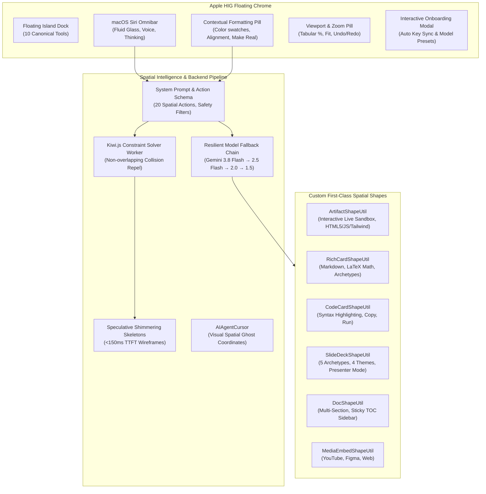
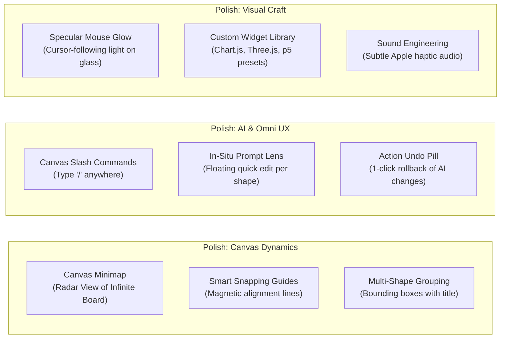

# visionOS — Comprehensive Feature Inventory, Inspiration Benchmarks & Future Roadmap

> **Historical status notice — 23 October 2026:** The feature statuses below are the original roadmap and are not current release verification. In particular, “In Production” headings and failover claims should not be read as a production-readiness checklist. See the [evidence-backed production audit](PRODUCTION_AUDIT_PLAN.md) for current checks, known limits and remaining verification. The original inventory and Swarm ideas are preserved.

This document compiles the complete inventory of features, ideas, architectural patterns, and design benchmarks discussed throughout the evolution of **visionOS**. It maps insights from reference repositories, identifies capabilities ready for implementation, highlights UI/UX and engine polish areas, and catalogs long-term moonshots.

---

## 1. Reference Repositories & Inspiration Benchmarks

During our research and benchmarking, we evaluated leading open-source projects across spatial canvases, generative AI, document architectures, and visual motion systems.

| Inspiration Repository | Core Concept & Mechanism | What visionOS Has Implemented | What Remains to Implement / Learn |
| :--- | :--- | :--- | :--- |
| **`tldraw/make-real`** & `make-real-starter` | Multimodal sketch-to-live-app synthesis via Gemini/GPT-4o vision prompts and sandboxed `iframe` rendering. | Base64 canvas viewport/selection capture, structured system prompt, sandboxed `ArtifactShapeUtil`, speculative shimmering skeletons. | **Multimodal Visual Annotation Loop** (drawing red circles/annotations over running apps to iterate); **Version History Diffing**; **1-click Code Export to GitHub/CodeSandbox**. |
| **`tldraw/agent-template`** | Spatial agent that acts on canvas shapes using discrete tool calls, streaming action frames, and multi-agent ghost cursors. | Spatial tool schemas (`create_rich_card`, `spawn_artifact`, `connect_shapes`, `align_shapes`, etc.), Kiwi.js solver worker, `AIAgentCursor`. | **Autonomous Self-Healing Loop** (agent tests generated app in sandbox, intercepts console errors, and fixes them autonomously); **Perception Gaze Indicator**. |
| **`hugohe3/ppt-master`** & `Kimi AI` / `Gamma.app` | Generative presentation engines with archetypal slide layouts, responsive aspect ratios, and native slide transitions. | Dedicated `SlideDeckShapeUtil`, 5 archetypal slide layouts, 4 obsidian glass themes, fullscreen presenter mode, slide pager dots. | **Native `.pptx` Binary Export & Import** (generating editable PowerPoint files via `pptxgenjs`); **Document-to-Deck Synthesizer** (1-click PDF/Report to 10-slide deck); **Speaker Notes & AI Narration Script**. |
| **`langchain-ai/open-canvas`** | Side-by-side artifact editing, localized inline code diffs, and rapid targeted adjustments. | Spatial omnibar with natural language tool execution, action compression badges, natural conversational summaries. | **Integrated Side-by-Side Code Diff Editor** (Monaco/CodeMirror split pane to live-edit HTML/JS); **Partial Selection AI Edit** (highlighting a single paragraph or function to refine). |
| **`Jakubantalik/Libraries.dev`** | Tactile physics and fluid visual FX (`thinking-orbs`, `voice-glow`, `border-beam`, `liquid-gooey`, `metal-fx`, `bot-avatars`). | `ThinkingOrb` (solving/breathing states), `VoiceGlow` audio indicator, concentric border radii, obsidian glass design tokens. | **Border Beam (`border-beam`)** (animated specular light traversing card perimeters during generation); **Liquid Gooey (`liquid-gooey`)** for grouping transitions; **Liquid Metal (`metal-fx`)** for buttons. |
| **`toeverything/AFFiNE`** | Unified dual-surface workspace: infinite edgeless canvas $\leftrightarrow$ structured page document editor. | Dedicated `DocShapeUtil` with LaTeX math ($...$, $$...$$), collapsible Table of Contents sidebar, markdown rendering. | **Edgeless $\leftrightarrow$ Page Mode Toggle** (expand any canvas doc into a distraction-free Notion-style full-page view); **Bi-directional Shape Linking (`[[Card Title]]`)**; **Interactive Database/Kanban Cards**. |
| **`SawyerHood/tlbrowse`** | Interactive live web browsing and viewport clipping directly inside the infinite canvas. | Media embedding for YouTube, Figma, and web URLs. | **Native Embedded Web Browser Shape** (interactive Chromium proxy shape that allows browsing live web pages, searching Google, and clipping DOM elements directly into canvas cards). |
| **`mrslimslim/gpt-image-canvas`** | Generative image canvas with localized inpainting, outpainting, and visual composition. | SVG vector generation, image placement via cards. | **Native Canvas Image Generator (`generate_image`)** via Imagen 3 / FLUX; **In-Situ Inpainting Brush** (masking canvas regions to regenerate via prompt). |
| **`CopilotKit` & `excalidraw-studio`** | In-canvas copilot with slash commands, ghost completions, and contextual canvas formatters. | Contextual formatting pill with dynamic positioning, quick swatches, Make Real trigger, ⌘K Omnibar. | **Canvas Slash Commands (`/`)** on blank space; **Ghost Shape Autocompletion** predicting the next logical architecture block. |
| **macOS Sequoia Siri & Apple HIG** | Translucent obsidian glass surfaces, specular edge highlights, fluid spring animations, tabular typography. | Apple-grade Island Dock, Viewport Pill, Pages Pill, Concentric Radius Formula ($R_o = R_i + P$), tabular numbers everywhere. | **Dynamic Specular Light Reflection** following mouse position; **Haptic/Subtle Sound Design** on tool clicks and card snapping. |

---

## 2. Currently Implemented Capabilities (Status: In Production)

* **Spatial Canvas Architecture**: `tldraw` v3 with custom shape utilities, dotted grid mode, and dark color scheme persistence.
* **Apple HIG Interface**: Clean obsidian surfaces (`backdrop-blur-3xl`, `rgba(18, 18, 24, 0.82)`), 1px specular highlight border (`border-white/10`), minimum $\ge 40\times 40\text{px}$ touch targets, tactile press scale (`0.96`), and strict concentric corner radii.
* **Smart Trackpad & Gesture Interceptor**: Boundary-aware wheel capture that prevents browser window zooming and seamlessly hands off card scrolling to infinite canvas panning.
* **Multi-Modal Make Real**: Instant wireframe capture to interactive live applications with Tailwind CSS, Chart.js, and virtual `localStorage` support.
* **Speculative Wireframe Skeletons**: Instant visual feedback displaying animated shimmering placeholders at the solved non-overlapping coordinates while LLM streams.
* **Live Reasoning & Status Animation**: Real-time Gemini thinking blocks display via `SiriThinkingAccordion` with rotating topology status indicators.
* **Bulletproof Model Failover**: Automatic fallback chain across Gemini models (`gemini-3.8-flash` $\rightarrow$ `gemini-2.5-flash` $\rightarrow$ `gemini-2.5-pro` $\rightarrow$ `gemini-2.0-flash` $\rightarrow$ `gemini-1.5-flash`) handling 404/400 errors seamlessly.
* **Onboarding & Credential Sync**: First-time user onboarding with auto-saved API keys, model preset selector, and sample starter playground.

---

## 3. High-Priority Features Yet to Be Implemented

These are concrete features discussed during development that represent the natural next step for **visionOS v1.1 - v1.3**:

### A. Native Presentation & Document File Export / Import (`hugohe3/ppt-master`)
* **Binary `.pptx` PowerPoint Export**:
  * Integrate `pptxgenjs` client-side so users can click **Export to PowerPoint** on any `SlideDeckShape` and receive a natively editable `.pptx` file with preserved layouts, tables, and colors.
* **Binary `.pptx` Import**:
  * Drag and drop an existing `.pptx` deck onto the canvas to parse it into individual editable canvas slides.
* **1-Click Document-to-Presentation Synthesizer**:
  * Select any `document` or `rich_card` on the canvas, open Omnibar, and request: *"Synthesize an 8-slide executive pitch deck from this spec"*.
* **Markdown & PDF Document Export**:
  * Direct 1-click export of `DocShape` to clean GitHub Flavored Markdown (`.md`) or formatted print PDF with page breaks.

### B. Interactive Sandbox Upgrades (`tldraw/make-real`)
* **Interactive App Version History & Rollback**:
  * Retain a discrete history of code versions inside each `ArtifactShape` props. Allow users to click `<` / `>` in the artifact header to revert to previous versions.
* **Visual Annotation Loop**:
  * Allow users to draw red arrows or sketch revision notes directly over an existing running app, then select both and trigger *"Update app based on my sketches"*.
* **Code Editor Drawer (Monaco / CodeMirror)**:
  * An expandable sliding drawer on the side of an artifact shape showing the raw HTML/JS code with live syntax highlighting and two-way hot-reloading.
* **Console Output & Error Overlay**:
  * Capture iframe `console.log` and `window.onerror` inside the sandbox to display an inline debug pill at the bottom of the artifact window.

### C. Multi-Agent Swarm Mode (Currently Labeled "Coming Soon")
* **Swarm Execution Engine**:
  * Activate `/api/ai/swarm` with parallel agent task execution.
  * Specialized agent roles:
    * **Architect**: Plans topology and dependency graphs.
    * **Frontend Engineer**: Synthesizes and styles interactive widgets.
    * **Technical Writer**: Produces detailed specifications and notes.
    * **Reviewer**: Inspects shapes for consistency and validates kiwi constraints.
* **Visual Swarm DAG on Canvas**:
  * Spawn lightweight floating task nodes that visualize the parallel subagent progress in real time with connector dependency lines.
* **Multi-Cursor Presence**:
  * Render multiple colored ghost agent cursors simultaneously across the canvas as each agent acts on different coordinates.

### D. Audio & Multimodal Live Streaming
* **Gemini Multimodal Live API (WebSockets / WebRTC)**:
  * Upgrade from the browser's built-in Web Speech API to Google's real-time Multimodal Live API.
  * Enable true sub-500ms bidirectional voice-to-voice conversation with natural voice interruptions (barge-in).
* **Voice-Driven Spatial Navigation**:
  * Voice commands like: *"Take me to the calculator app"*, *"Zoom in on the architecture diagram"*, *"Organize these cards into a 3-column grid"*.

---

## 4. UI/UX & Engine Polish Improvements

Refinements identified to elevate visionOS from production MVP to industry-defining craft:

1. **Canvas Radar Minimap**:
   * A collapsible miniature overview pill in the bottom corner showing the full infinite canvas topology and current camera viewport.
2. **Magnetic Smart Alignment Guides**:
   * Interactive alignment guidelines (red/indigo dashed lines) that appear when dragging cards near other cards' centers or edges.
3. **Canvas Slash Menu (`/`)**:
   * Clicking anywhere on empty canvas and typing `/` summons an instant popup palette to insert Notes, Live Apps, Slides, Documents, or Media without reaching for the bottom dock.
4. **Specular Edge Reflection**:
   * A dynamic CSS radial gradient on floating HUD elements that tracks cursor coordinates, mimicking Apple VisionOS physical glass lighting.
5. **Multi-Selection Mass Formatting**:
   * When selecting 3+ cards, provide mass actions in the Contextual Formatting Pill: *"Align Horizontally"*, *"Distribute Evenly"*, *"Unify Color Theme"*, *"Pack into Group"*.
6. **Subtle Audio Design**:
   * Optional gentle, tactile micro-sound effects (woodblock tick on dock switch, gentle paper whisper on card spawn, soft chime on AI completion).

---

## 5. Long-Term Vision & Moonshot Ideas

Transformative concepts envisioned for future generations of the visionOS platform:

### 1. Apple Vision Pro & WebXR Spatial Immersion
* **True 3D Spatial Canvas**:
  * Using WebXR in Safari on VisionOS to render canvas cards in 3D physical space with real Z-axis depth.
  * Direct hand pinch gestures to grab, pull closer, or push back interactive app windows in room space.
  * Eye-tracking focus: looking at a card automatically focuses the AI chat context on that specific entity.

### 2. Real-Time Collaborative Multiplayer (Yjs / Liveblocks)
* **Multi-User Infinite Canvas**:
  * Synchronize canvas store over WebSockets using Yjs CRDTs or Liveblocks.
  * See teammates' live Apple-style named cursors panning and drawing across the board.
  * Shared AI sessions where multiple team members watch and converse with the spatial AI simultaneously.

### 3. Native Embedded Browser & Web Scraper (`tlbrowse`)
* **Live Web Node**:
  * An interactive browser shape powered by a cloud Chromium session that renders live websites on canvas.
  * Allows users to test production deployments directly beside their design notes.
  * 1-click "Clip to Canvas" that grabs DOM components or screenshots directly from the web node.

### 4. Semantic Spatial Memory & Vector Board Search
* **Spatial Memory Index**:
  * Embed all text, code, and diagram topology from all user boards into local vector storage (sqlite-vss / IndexedDB).
  * Omnibar can answer cross-board queries: *"Where did we design the authentication microservice last week?"* and smoothly pan the camera to that exact cluster.

### 5. Third-Party Plugin & Widget Ecosystem
* **Community Widget Marketplace**:
  * Allow developers to author custom tldraw shape plugins (e.g. 3D Spline viewer, TradingView stock widget, Jupyter python notebook, Excalidraw whiteboard bridge).
  * 1-click installation of shape packs directly from the visionOS settings drawer.

---

## 6. Execution Priority Matrix

| Horizon | Phase | Key Deliverables | Estimated Complexity |
| :--- | :--- | :--- | :--- |
| **Near Term** | **v1.1 (Export & Edit Polish)** | 1. Native PPTX & PDF Export 2. Monaco/CodeMirror code editor drawer on Artifacts 3. Canvas Slash Menu (`/`) 4. Canvas Minimap | Medium (1-2 weeks) |
| **Mid Term** | **v1.2 (Agentic Swarm & Vision)** | 1. Full Multi-Agent Swarm mode with DAG visualizer 2. Visual Annotation Loop (draw on apps to iterate) 3. Multi-cursor agent presence 4. Console error auto-healing | High (2-3 weeks) |
| **Long Term** | **v2.0 (Spatial & Multiplayer)** | 1. Real-time Multiplayer (Yjs / WebSockets) 2. Gemini Multimodal Live API (Sub-500ms voice) 3. WebXR / Apple Vision Pro spatial depth mode 4. Semantic cross-board vector search | Very High (1-2 months) |

---
*Roadmap generated from visionOS design iterations, user requirements, and technical benchmarks.*
